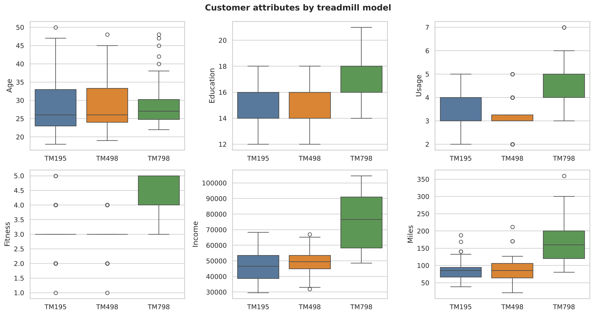

# Python Learning Notebooks and CardioGood Fitness Analysis

Notebooks from learning Python for data analysis in 2022, and one complete analysis built on what they cover.

## Project

**[CardioGood Fitness: customer profile of each treadmill](cardiogood_fitness_analysis/)**: who buys each of three treadmill models, based on 180 customers. Every customer earning over $70k bought the premium TM798, 29 of the 31 customers with the top fitness rating chose it, and the two cheaper models attract almost identical customers. Includes findings, charts and positioning suggestions for each model.



## Learning notebooks

Study notebooks, kept as a record of the basics. They work through the libraries one feature at a time and are not projects.

| Notebook | Covers |
|---|---|
| [01 Python data structures](notebooks/01_python_data_structures.ipynb) | Lists, tuples, sets and dictionaries |
| [02 NumPy and pandas basics](notebooks/02_numpy_and_pandas_basics.ipynb) | Creating and slicing arrays, array maths, Series and DataFrames, reading CSV files |
| [03 Matplotlib basics](notebooks/03_matplotlib_basics.ipynb) | Line, scatter and bar charts, markers, colours, labels, grids and subplots |
| [04 Seaborn visualization](notebooks/04_seaborn_visualization.ipynb) | Relational, categorical, distribution and pairwise plots on an automobile dataset |
| [05 CardioGood Fitness walkthrough](notebooks/05_cardiogood_fitness_walkthrough.ipynb) | First exploration of the dataset used in the project above |

Notebooks 01 and 02 were re-run after fixing cells that previously ended in errors (variables named `list`, `set` and `tuple` that hid Python's built-ins, and a CSV file that wasn't included).

## Run

```bash
pip install pandas numpy matplotlib seaborn jupyter
jupyter notebook
```
