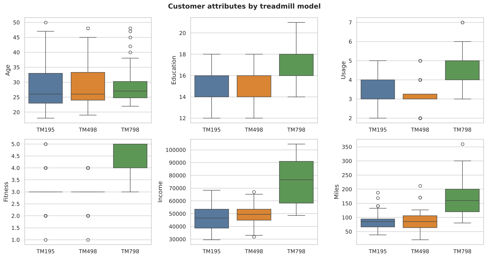
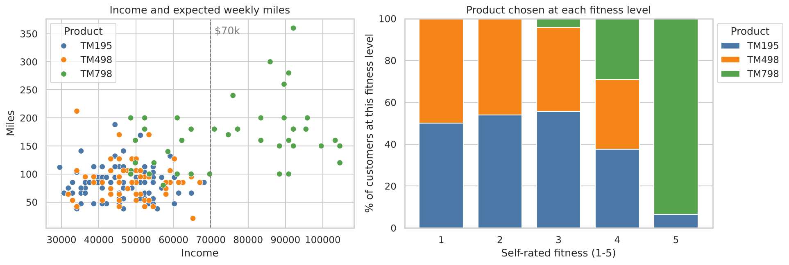
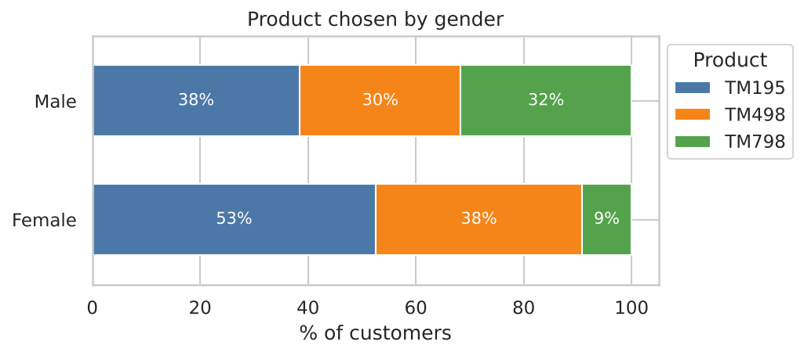

# CardioGood Fitness: Customer Profile of Each Treadmill

**Who buys each of three treadmill models, and how should each be marketed? An exploratory analysis of 180 customers in Python (pandas, seaborn).**

📓 [Analysis notebook](analysis.ipynb) · 🗂️ [Data](data/CardioGoodFitness.csv)

## Key findings

| Product | Share of sales | Typical customer (medians) | Suggested positioning |
|---|---|---|---|
| **TM195** | 44% (80) | Age 26, income $46.6k, 3 uses a week, fitness 3/5, 85 miles a week; 50% men | Entry-level, value model for everyday home fitness |
| **TM498** | 33% (60) | Almost identical to TM195: income $49.5k, 3 uses a week, fitness 3/5, 85 miles | Mid-range model that needs a clearer difference from TM195 |
| **TM798** | 22% (40) | Income $76.6k, 18 years of education, 5 uses a week, fitness 5/5, 160 miles; 82.5% men | Premium model for serious runners and high earners |

- **Every customer earning over $70k bought the TM798** (23 customers); no TM195 or TM498 buyer earned more than $68.3k.
- **29 of the 31 customers who rate their fitness 5/5 bought the TM798.**
- **Women rarely bought the TM798:** 9.2% of women (7 of 76) against 31.7% of men (33 of 104).
- Age and marital status make little difference to the model chosen.
- Planned usage, expected miles and fitness are strongly related (correlations 0.67–0.79); income is moderately related to all three (about 0.5).







## Approach

1. **Data checks:** 180 rows and 9 columns, with no missing values, no duplicates and all values in sensible ranges.
2. **Product mix** and **customer profile** for each model: means and medians of the numeric measures, and shares by gender, marital status, income band, education and fitness.
3. **Premium buyers:** income threshold, fitness levels and weekly miles of TM798 buyers.
4. **Gender and marital status:** the product chosen within each group.
5. **Correlations** between the six numeric measures.
6. **Findings and suggestions** for positioning each model.

## Limitations

- 180 customers from one retailer, with no prices, dates or store information, so the patterns describe these buyers rather than all treadmill customers.
- Usage, fitness and miles are what customers expected or reported when buying, not measured use.
- Some groups are small (40 TM798 buyers, 7 of them women), so subgroup percentages are uncertain.

## Data

CardioGood Fitness customer dataset: a public case-study dataset widely used for teaching analytics. Columns: Product, Age, Gender, Education (years), MaritalStatus, Usage (planned times a week), Fitness (self-rated 1–5), Income (USD a year), Miles (expected a week).

## Run it

```bash
pip install pandas numpy matplotlib seaborn jupyter
jupyter notebook analysis.ipynb
```
